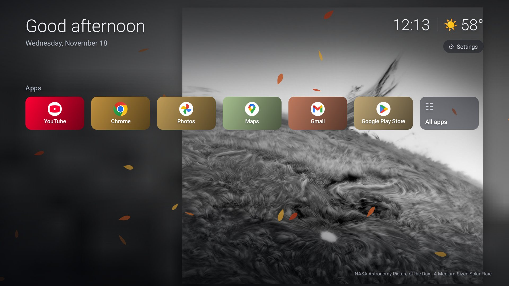
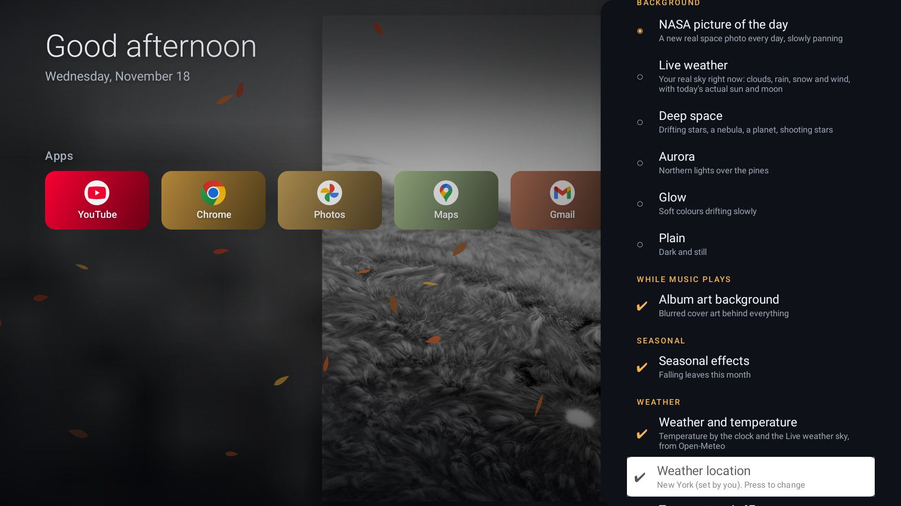
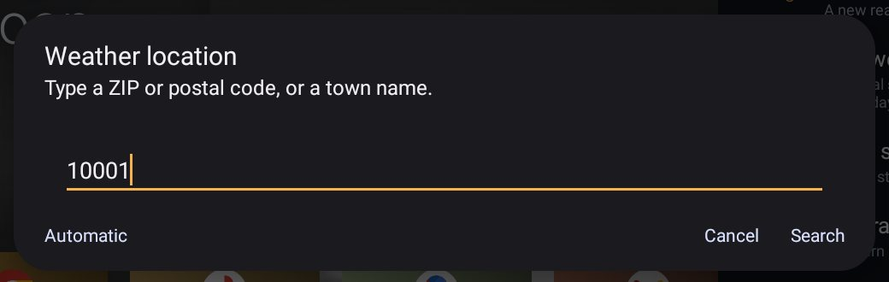

# TV Home for Home Assistant

[TV Home](https://github.com/CESMOtacon/tv-home) plus Home Assistant: your lights and scenes, every camera, and a
doorbell pop-up, right on the TV's home screen. Everything about your house is set up in one file (`ha.json`);
nothing is hard-coded.

A calm, ad-free home screen for Google TV and Android TV. Your apps in the order you like, the clock and the
outdoor temperature, and a background that's actually worth looking at: NASA's picture of the day, a live sky
that matches the weather outside your window, or slow drifting space and aurora scenes.

It sits on top of Google TV instead of replacing it. Nothing on the TV is disabled or removed, and uninstalling
it puts everything back exactly as it was.



**Live weather**: the background that shows your real sky right now.

| Sunset | Rain | Night |
|---|---|---|
|  |  |  |
| **Snow** | **Thunderstorm** | **Sun behind a cloud** |
|  |  |  |

## What the Home Assistant edition adds

- **A Lights group**: tiles for your scripts, scenes and light shows. A running show glows in its own colours
  (and so does the *Glow* background); press it again to stop it, or press *Lights back* to end everything.
- **A Cameras group**: the front door camera in a pop-up, and *All cameras*: every camera on one screen, live on
  the one you're on, full screen in HD with OK.
- **A doorbell pop-up over whatever you're watching** when someone rings, with buttons that speak a reply through
  the doorbell (for example "Be right there"), and an optional quieter preview when a car pulls in.
- **Status pills** next to Settings for any sensors you like.
- **Live weather from your own weather station**: cloud cover from your solar sensor (the sun really goes behind
  a cloud when your light level drops), rain from your rain gauge, wind and gusts from your anemometer.

Setup: [docs/HOME-ASSISTANT.md](docs/HOME-ASSISTANT.md).

## Everything from TV Home

- **Your apps, your order.** The Apps row shows your favourites; hold OK on an app to move it or take it off, and
  add more from *All apps*. No sponsored rows, no "recommended for you".
- **HDMI inputs** appear only when something is plugged in and switched on.
- **Clock with the outdoor temperature** and a little weather icon. Weather is optional (Settings → Weather);
  type a ZIP code or town to set where it's for, or let TV Home work out your area.
- **Backgrounds** (Settings → Background):
  - *NASA picture of the day*, slowly panning.
  - *Live weather*: your real sky right now, drawn from the current weather where you are. Clouds come and go,
    rain falls harder or softer and slants with the wind, snow, fog, lightning in a thunderstorm. The sun is
    NASA's live picture of it (today's real sunspots) and sits where the sun actually is in your sky; at night
    the moon is NASA's picture of tonight's moon, in its real phase and position.
  - *Deep space*, *Aurora*, *Glow* and *Plain*.
- **Album art** fills the background while music plays (Spotify and others), with the track shown up top.
- **Seasonal touches**: falling leaves in autumn, snow in winter, fireworks on New Year's Eve and the 4th of July,
  hearts on Valentine's Day. Leaves and snow drift with the real wind and swirl when a gust comes through.
- **Ambient clock** after two minutes: a big quiet clock over the background. Prefer the TV's own screensaver
  (Google's photo slideshows)? Settings → When idle turns the clock off.
- **Remote sounds**: a soft pop as the selection moves and a deeper one on OK, quieter than most TVs' own UI sounds
  (Settings → Sounds switches them off).
- **Home button (optional).** Google TV doesn't let other apps take over the Home button, so TV Home includes a
  small helper that can send Home to TV Home instead. It's off until you turn it on.

## Weather location

Weather is optional: **Settings → Weather → Weather and temperature** turns it off completely (no weather, no
location lookups). To choose where it's for, open **Settings → Weather → Weather location**, type a ZIP or postal
code (or a town name) with the remote, and pick the right place if there's more than one. From then on TV Home uses
exactly that place and stops guessing your area from your internet address. **Automatic** switches back.
In this edition, if `ha.json` has a `weather` section (your station), the weather and the sky follow Home
Assistant's home location instead, and Settings says so.

| Weather settings | Typing a ZIP code |
|---|---|
|  |  |

## Install

You'll need a computer on the same Wi-Fi as the TV for about 20 minutes. Step-by-step instructions, no
experience needed: **[INSTALL.md](INSTALL.md)**.

The APK is on the [Releases](../../releases) page. Then connect it to Home Assistant:
[docs/HOME-ASSISTANT.md](docs/HOME-ASSISTANT.md).

## Privacy

No accounts, no analytics, no ads. TV Home only talks to these, and only for what's on your screen:

| What | Who | When |
|---|---|---|
| Picture of the day | NASA (science.nasa.gov) | Once a day, if that background is chosen |
| Weather | [Open-Meteo](https://open-meteo.com) (your approximate coordinates) | Every 15 minutes while TV Home is on screen |
| Your approximate location for the weather | ipapi.co, or ipwho.is if that fails (city level, from your internet address) | Once a week, and only until you set a location yourself |
| Finding a place you type in Settings | Open-Meteo's place search | When you search |
| Live sun and moon pictures | NASA (sdo.gsfc.nasa.gov, svs.gsfc.nasa.gov) | While *Live weather* is showing: sun every 20 min, moon hourly |
| Your Home Assistant | Only the address in your `ha.json` | Always connected (local network), to show states and the doorbell |

With a `weather` section in `ha.json`, the weather comes from Home Assistant instead, and Open-Meteo and the
location lookup aren't used.

Turning off *Settings → Weather and temperature* stops the weather and location lookups entirely. To skip the
automatic location, type your ZIP code or town in *Settings → Weather location*.

The helper behind the Home button option is an Android accessibility service, because that's the only way an app
can hear the Home button on Google TV. It only listens for the Home key and for Google's home screen opening; it
doesn't read anything on screen.

## Editions

- **[TV Home](https://github.com/CESMOtacon/tv-home)**: works on its own, no Home Assistant needed.
- **TV Home for Home Assistant** (this repository): TV Home plus everything above. It's built on TV Home's code
  (same history); `Edition.kt` and the `Ha*.kt` files are where they differ.

## Building from source

Android Studio, or JDK 17+ and the Android SDK:

```
./gradlew assembleDebug        # app/build/outputs/apk/debug/app-debug.apk
```

Release builds are signed only if you add a `keystore.properties` (see `app/build.gradle.kts`).

Written in Kotlin with plain Android views; everything is drawn in 1920×1080 "design pixels" and scaled to the
screen. The Home Assistant parts: `Edition.kt`, `HaConfig.kt` (ha.json and the adb setup endpoint), `Ha.kt`
(websocket client), `HaHome.kt` (rows and pills), `HaHelper.kt` (doorbell), `StationWeather.kt`,
`DoorbellPopup.kt` and `CamerasActivity.kt`.

## Credits

- Weather data by [Open-Meteo.com](https://open-meteo.com/) ([CC BY 4.0](https://creativecommons.org/licenses/by/4.0/)).
- Astronomy Picture of the Day: [NASA](https://science.nasa.gov/apod/) (each picture's credit is shown with it).
- Sun: NASA's [Solar Dynamics Observatory](https://sdo.gsfc.nasa.gov/) (HMI). Moon: NASA Scientific Visualization
  Studio, [Dial-a-Moon](https://svs.gsfc.nasa.gov/help/#apis-dialamoon).
- Not affiliated with Google, NASA or Open-Meteo.

## License

[MIT](LICENSE)
